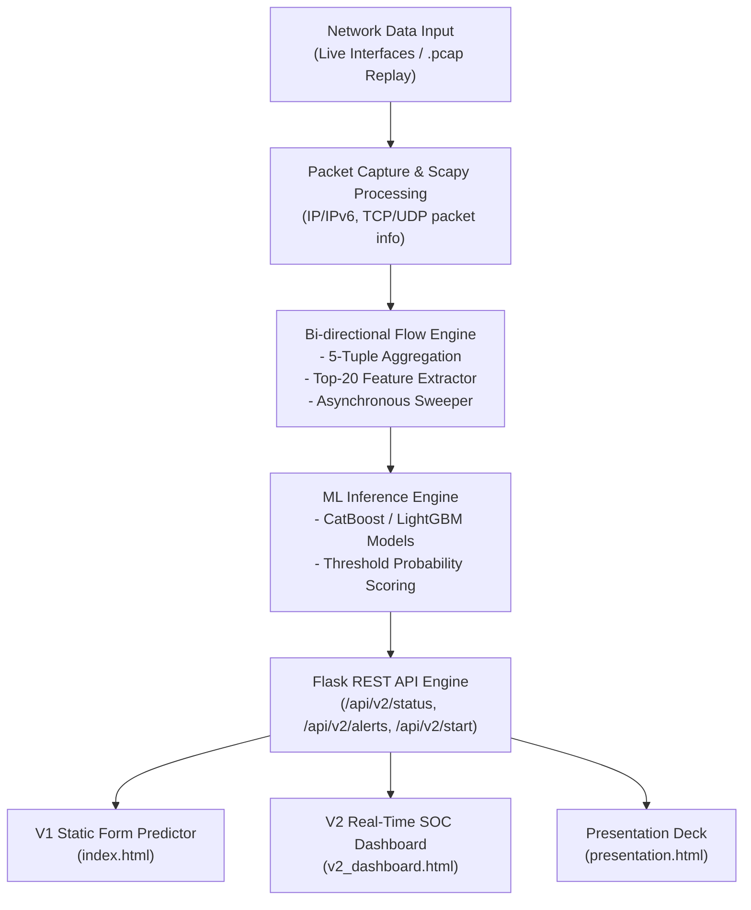

# NIDS-AI: Project Description, Architecture & Tech Stack

## 1. Project Description

**NIDS-AI** is a machine-learning-powered **Network Intrusion Detection System** trained on the **CICIDS2017** benchmark dataset (~2.52M network flow records). 

### Core Objective
The system monitors network flow characteristics to classify traffic as either **`BENIGN`** or **`ATTACK`**. Unlike conventional academic implementations that suffer from data leakage (overfitting caused by duplicate flows across random train/test splits), NIDS-AI enforces a **leakage-free evaluation methodology**:
- **Deduplication & Data Sanitation**: Removes duplicate flow entries to prevent test-set memorization.
- **Sequential Splitting**: Splits data chronologically (~70% train / 10% validation / 20% test) to mirror real-world temporal shift where attack patterns differ over time.
- **Dimensionality Reduction**: Reduces 78 raw network features down to **20 optimal features** without sacrificing predictive power.
- **Validation-Only Threshold Selection**: Calibrates decision boundaries on validation sets to handle class imbalance before evaluating on the untouched test set.

### Key Performance Highlights (Final Top-20 Leakage-Free Model)
- **Accuracy**: 99.01%
- **Precision**: 99.10%
- **Recall**: 97.92%
- **F1-Score**: 98.50%
- **ROC-AUC**: 99.90%

### Operating Capabilities
1. **Static Predictor (V1)**: Web interface for manual feature entry and instant probability scoring.
2. **Real-Time SOC Dashboard & Sniffer (V2)**: Live network packet sniffing via Scapy, real-time 5-tuple flow aggregation, automated threat level assessment, PCAP file replay, and attack simulation.

---

## 2. System Architecture

### Subsystem Breakdown

1. **Offline ML Pipeline & Model Training** ([`scripts/`](file:///d:/Projects/NIDS-AI/scripts))
   - Data cleaning, duplicate removal, and invalid value filtering ([`clean_features.py`](file:///d:/Projects/NIDS-AI/scripts/clean_features.py), [`remove_duplicates.py`](file:///d:/Projects/NIDS-AI/scripts/remove_duplicates.py)).
   - Group leakage detection & time-ordered sequential dataset partitioning ([`analyze_group_leakage.py`](file:///d:/Projects/NIDS-AI/scripts/analyze_group_leakage.py)).
   - Feature selection & threshold stability verification ([`select_top_features.py`](file:///d:/Projects/NIDS-AI/scripts/select_top_features.py)).
   - Automated end-to-end workflow execution ([`safe_workflow.py`](file:///d:/Projects/NIDS-AI/scripts/safe_workflow.py)).

2. **Real-Time Live Detector Engine** ([`v2/live_detector.py`](file:///d:/Projects/NIDS-AI/v2/live_detector.py))
   - **`Flow` Class**: Tracks forward/backward packet counts, flow bytes, header lengths, and inter-arrival times (IAT).
   - **`LiveDetectorEngine` Thread**: Asynchronously captures raw packets, maintains flow state tables, runs periodic sweeper flushes, and invokes model prediction.
   - **Attack Simulator** ([`v2/attack_simulator.py`](file:///d:/Projects/NIDS-AI/v2/attack_simulator.py)): Generates test network packet bursts to validate detection alerts in real time.

3. **Backend API Service** ([`app/app.py`](file:///d:/Projects/NIDS-AI/app/app.py))
   - Web application providing HTTP REST endpoints for controlling sniffer states, querying threat alerts, and executing manual predictions.

4. **Frontend Security Operations Center (SOC)** ([`app/templates/`](file:///d:/Projects/NIDS-AI/app/templates))
   - UI with live statistics cards (Threat Level, Active Flows, Packets Processed, Attack vs Benign ratios) and interactive alerts.

---

## 3. Technologies Used

| Category | Technology / Library | Purpose & Usage |
|---|---|---|
| **Core Language** | Python 3.x | Entire backend, data engineering, model training, and packet sniffing. |
| **Machine Learning** | **CatBoost** | Primary high-performance gradient boosted decision tree classifier (`.cbm`). |
| | **LightGBM** | Fast tree-based boosting framework (`.pkl`). |
| | **scikit-learn** | Metrics evaluation, threshold calibration, and decision tree baseline comparisons. |
| | **joblib** | Model serialization and rapid disk loading. |
| **Data Processing** | **Pandas** & **NumPy** | Dataframe manipulation, batch aggregation, and vector mathematical operations. |
| **Network Processing** | **Scapy** | Live network socket sniffing, packet decoding (IP, IPv6, TCP, UDP), and PCAP file replay. |
| **Backend & Web API** | **Flask** | Lightweight WSGI web framework and REST API engine. |
| | **python-dotenv** | Environment configuration parsing ([`.env`](file:///d:/Projects/NIDS-AI/.env)). |
| **Frontend & UI** | **HTML5 & CSS3** | Modern responsive glassmorphism UI templates ([`style.css`](file:///d:/Projects/NIDS-AI/app/static/style.css)). |
| | **JavaScript (ES6)** | Asynchronous REST polling (`fetch`), dynamic DOM updates, and alert feed rendering. |
| **Data Visualization** | **Matplotlib** & **Seaborn** | Offline generation of feature importance charts, confusion matrices, and ROC curves ([`results/plots/`](file:///d:/Projects/NIDS-AI/results/plots/)). |
