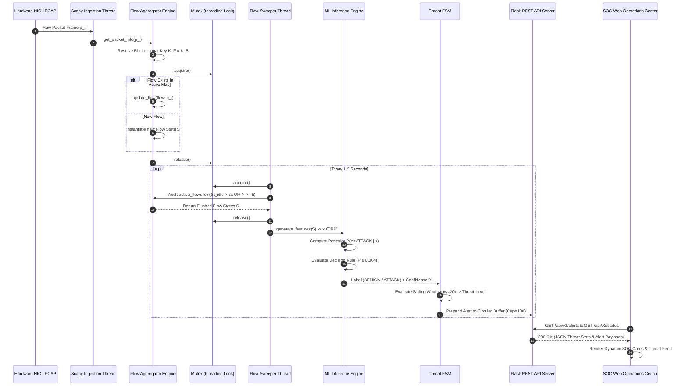

# NIDS-AI: Intellectually Precise System Architecture & Technical Specifications

## 1. Mathematical & System Formalism

NIDS-AI is a stateful, real-time Network Intrusion Detection System designed for high-throughput network flow classification. It eliminates class-imbalance bias and temporal data leakage using a mathematically grounded, sequential learning pipeline.

---

### 1.1 Bi-Directional 5-Tuple Flow Aggregation Formalism

Let a captured network packet $p_i$ at time $t_i \in \mathbb{R}^+$ be represented by:
$$p_i = (\text{IP}_{\text{src}}, \text{IP}_{\text{dst}}, P_{\text{src}}, P_{\text{dst}}, \text{Proto}, L_i, t_i)$$

Where:
- $\text{IP}_{\text{src}}, \text{IP}_{\text{dst}} \in \mathcal{I}$ (IPv4 / IPv6 Address Space)
- $P_{\text{src}}, P_{\text{dst}} \in \{0, \dots, 65535\}$ (Transport Layer Ports)
- $\text{Proto} \in \{\text{TCP}, \text{UDP}\}$ (Transport Protocol)
- $L_i \in \mathbb{N}^+$ (Packet Frame Length in Bytes)
- $t_i \in \mathbb{R}^+$ (Unix Epoch Arrival Timestamp)

A **5-Tuple Flow Key** $K$ is defined over the space $\mathcal{K} = \mathcal{I} \times \mathcal{I} \times \mathcal{P} \times \mathcal{P} \times \text{Proto}$. We define a bi-directional equivalence relation $\equiv$ over $\mathcal{K}$:
$$K_F = (ip_s, ip_d, p_s, p_d, \text{proto}) \equiv K_B = (ip_d, ip_s, p_d, p_s, \text{proto})$$

A **Flow State Object** $\mathcal{S}$ aggregates packets sharing key $K$ within a time window $\Delta t_{\text{idle}} \le \tau_{\text{timeout}}$:
$$\mathcal{S} = \Big( t_{\text{start}}, t_{\text{last}}, N_{\text{fwd}}, N_{\text{bwd}}, B_{\text{fwd}}, B_{\text{bwd}}, \mathbf{L}_{\text{fwd}}, \mathbf{L}_{\text{bwd}}, \mathbf{L}_{\text{pkt}} \Big)$$

Where:
- $t_{\text{start}} = \min(t_i)$, $t_{\text{last}} = \max(t_i)$
- $N_{\text{fwd}}, N_{\text{bwd}}$ are forward and backward packet counts
- $B_{\text{fwd}}, B_{\text{bwd}}$ are accumulated byte volumes
- $\mathbf{L}_{\text{fwd}}, \mathbf{L}_{\text{bwd}}, \mathbf{L}_{\text{pkt}}$ are vectors of individual frame lengths

---

### 1.2 Feature Extraction Mapping $\phi(\mathcal{S}) \to \mathbf{x} \in \mathbb{R}^{20}$

The raw flow state $\mathcal{S}$ is projected into a 20-dimensional feature space $\mathbf{x} \in \mathbb{R}^{20}$:

$$\mathbf{x} = \Big[ x_1, x_2, \dots, x_{20} \Big]^T$$

Key mathematical feature formulations:
1. **Destination Port**: $x_1 = P_{\text{dst}}$
2. **Flow Duration**: $x_2 = (t_{\text{last}} - t_{\text{start}}) \times 10^6 \, \mu\text{s}$
3. **Packet Length Mean**: $x_6 = \frac{1}{N_{\text{fwd}} + N_{\text{bwd}}} \sum L_i$
4. **Packet Length Variance**: $x_{20} = \frac{1}{N - 1} \sum_{i=1}^N (L_i - \bar{L})^2$
5. **Flow Bytes/Second**: $x_{18} = \frac{B_{\text{fwd}} + B_{\text{bwd}}}{\max(10^{-6}, t_{\text{last}} - t_{\text{start}})}$
6. **Inter-Arrival Time (IAT) Metrics**: Mean ($\mu_{\text{IAT}}$), Min ($\min \Delta t$), and Total duration ($t_{\text{last}} - t_{\text{start}}$).

---

### 1.3 Machine Learning Decision Boundary & Calibration

Let $f_\Theta(\mathbf{x}) \in [0, 1]$ represent the posterior probability estimate $P(Y = \text{ATTACK} \mid \mathbf{x})$ output by the CatBoost / LightGBM ensemble.

The final decision rule $g(\mathbf{x})$ is defined as:
$$g(\mathbf{x}) = \begin{cases} 
1 \text{ (ATTACK)}, & \text{if } f_\Theta(\mathbf{x}) \ge \tau_{\text{optimal}} \\ 
0 \text{ (BENIGN)}, & \text{if } f_\Theta(\mathbf{x}) < \tau_{\text{optimal}} 
\end{cases}$$

#### Validation Threshold Optimization
Due to spatial class imbalance ($P(Y=1)_{\text{train}} \approx 13.8\%$ vs $P(Y=1)_{\text{test}} \approx 32.8\%$), standard thresholding $\tau = 0.50$ produces high false-negative rates. The threshold $\tau^*$ is chosen strictly on validation set $\mathcal{D}_{\text{val}}$ by maximizing $F_1(\tau)$:
$$\tau^* = \arg\max_{\tau \in (0, 1)} F_1\Big(\mathcal{D}_{\text{val}}, \tau\Big) = 0.004$$

---

## 2. Multi-Threaded Concurrency & Runtime Execution Architecture

The real-time detection engine ([`v2/live_detector.py`](file:///d:/Projects/NIDS-AI/v2/live_detector.py)) uses an asynchronous, thread-safe execution topology to prevent packet loss under high data rates.

```mermaid
graph TB
    subgraph Layer1 [Layer 1: Hardware Packet Ingestion]
        NIC["Physical / Virtual NIC"] -->|Raw L2/L3 Socket Frames| Scapy["Scapy Sniffer Thread<br/><code>v2/live_detector.py</code>"]
        PCAP[".pcap Files"] -->|Binary Stream| Scapy
    end

    subgraph Layer2 [Layer 2: Stateful Bi-Directional Flow Engine]
        Scapy -->|Raw Frames| HeaderParser["Header Decoder & Packet Filter<br/>Extracts: <i>(IP_src, IP_dst, P_src, P_dst, Proto, L_i, t_i)</i>"]
        HeaderParser -->|5-Tuple Payload| KeyResolver["Bi-directional 5-Tuple Key Resolver<br/><i>K_F = (ip_s, ip_d, p_s, p_d, proto) ≡ K_B</i>"]
        KeyResolver -->|Thread-Safe Insertion| MutexGuard["Reentrant Mutex Guard<br/><code>threading.Lock()</code>"]
        MutexGuard --> FlowMap["Active Flow State Table<br/><code>Dict[Tuple, Flow]</code>"]
    end

    subgraph Layer3 [Layer 3: Asynchronous Flow Sweeper]
        SweeperDaemon["Background Sweeper Thread<br/><i>Interval: T_sweep = 1.5s</i>"] -->|Periodic Audit| FlowMap
        FlowMap -->|Evict if: Δt_idle > 2.0s OR N_total ≥ 5| Vectorizer["Top-20 Feature Vectorizer<br/><i>phi(S) → x ∈ ℝ²⁰</i>"]
    end

    subgraph Layer4 [Layer 4: ML Inference Engine & Decision Boundary]
        Vectorizer -->|Matrix x ∈ ℝ²⁰| MLModel["CatBoost / LightGBM Ensemble<br/><i>leakage_free_top20_model.cbm</i>"]
        MLModel -->|Posterior P(Y=1|x)| ThresholdEval["Calibrated Decision Boundary<br/><i>y = 1 if P(Y=1 | x) ≥ 0.004 else 0</i>"]
    end

    subgraph Layer5 [Layer 5: Threat FSM & Alert Manager]
        ThresholdEval -->|Classification Label| AlertGen["Alert Dict Builder<br/><i>(ID, Timestamp, IPs, Ports, Confidence)</i>"]
        AlertGen -->|Prepend Alert| ThreatFSM["Threat FSM Evaluator<br/><i>Sliding Window: w = 20 Recent Flows</i>"]
        ThreatFSM -->|Update LOW/MED/HIGH/CRIT| CircularBuffer["Bounded Circular Buffer<br/><code>List[Dict] (Capacity = 100)</code>"]
    end

    subgraph Layer6 [Layer 6: REST API & SOC Operations Center]
        CircularBuffer --> FlaskApp["Flask WSGI Application<br/><code>app/app.py</code>"]
        FlaskApp --> Endpoints["REST API Endpoints:<br/><code>GET /api/v2/alerts</code><br/><code>GET /api/v2/status</code><br/><code>POST /api/v2/start</code>"]
        Endpoints -->|JSON REST Stream| SOCDashboard["SOC Web Dashboard<br/><code>v2_dashboard.html</code>"]
    end
```

### 2.1 Dynamic End-to-End Sequence Diagram



---

### 2.1 Concurrency & Mutex Protocols

To prevent race conditions during high-rate packet extraction and simultaneous API reads, all shared states are synchronized via a reentrant mutex block `threading.Lock()`:

| Resource | Protected Entity | Lock Operation Scope |
|---|---|---|
| `self.active_flows` | Hash Map `Dict[5-Tuple, Flow]` | Packet insertion, flow update, sweeper eviction. |
| `self.stats` | Atomic Counters & Timestamps | Packets processed, active flow count, threat state update. |
| `self.alerts` | Circular Buffer `List[Dict]` | Alert prepending (`insert(0, alert)`), eviction (`pop()`). |

---

### 2.2 Threat Severity Finite State Machine (FSM)

Threat severity is evaluated continuously using a sliding window over the last 20 classified flow vectors:

Let $A_{20} = \{a_1, a_2, \dots, a_{20}\}$ be the recent alert sequence. The threat level $T \in \{\text{LOW}, \text{MEDIUM}, \text{HIGH}, \text{CRITICAL}\}$ transitions according to:

$$T(A_{20}) = \begin{cases}
\text{CRITICAL}, & \text{if } \sum_{i=1}^{20} \mathbb{I}(a_i = \text{ATTACK}) \ge 10 \\
\text{HIGH}, & \text{if } 5 \le \sum_{i=1}^{20} \mathbb{I}(a_i = \text{ATTACK}) < 10 \\
\text{MEDIUM}, & \text{if } 1 \le \sum_{i=1}^{20} \mathbb{I}(a_i = \text{ATTACK}) < 5 \\
\text{LOW}, & \text{otherwise}
\end{cases}$$

---

## 3. Data Leakage Elimination & Validation Methodology

Conventional NIDS literature reports artificial accuracy metrics due to two key flaws, both resolved in this architecture:

```
                  RAW CICIDS2017 FLOW DATASET (2,519,506 rows)
                                      │
                                      ▼
                        Deduplication Filter
               (Removes duplicate flow key/value pairs)
                                      │
                                      ▼
                   Sequential Time-Ordered Split
               (Preserves real-world temporal distribution)
            ┌─────────────────────────┬───────────────┬────────────────────────┐
            │                         │               │                        │
            ▼                         ▼               ▼                        ▼
       Train Set               Validation Set     Test Set             Test Evaluation
       (~70% Time)               (~10% Time)     (~20% Time)              (UNTOUCHED)
   (13.8% Attack Rate)       (Threshold Tuning) (32.8% Attack Rate)   (Evaluated Once at end)
```

1. **Sub-packet Duplicate Overlap**: Identical flow entries generated by persistent attacks span across random train/test splits, causing memorization. **Solution**: Pre-split deduplication of raw feature rows.
2. **Temporal Group Leakage**: Random partitioning mixes future flow contexts into training sets. **Solution**: Non-random, time-ordered sequential splitting ($T_{\text{train}} \prec T_{\text{val}} \prec T_{\text{test}}$).

---

## 4. Subsystem Software Interface Matrix

| Subsystem Module | File Link | Primary Interface & Responsibilities |
|---|---|---|
| **Data Sanitation & Deduplication** | [`clean_features.py`](file:///d:/Projects/NIDS-AI/scripts/clean_features.py) | Strips whitespace, sanitizes header names, removes infinite/NaN values. |
| **Leakage Auditor** | [`analyze_group_leakage.py`](file:///d:/Projects/NIDS-AI/scripts/analyze_group_leakage.py) | Quantifies flow key overlap across splits; confirms non-overlapping partitions. |
| **Feature Extractor (V2)** | [`simple_feature_extractor.py`](file:///d:/Projects/NIDS-AI/v2/simple_feature_extractor.py) | Extracted 10 basic metrics directly from `.pcap` byte streams. |
| **Live Hardware Sniffer Engine** | [`live_detector.py`](file:///d:/Projects/NIDS-AI/v2/live_detector.py) | Multithreaded Scapy packet ingestion, flow table state management, and inference call. |
| **REST API Server** | [`app.py`](file:///d:/Projects/NIDS-AI/app/app.py) | Exposes `/api/v2/start`, `/api/v2/stop`, `/api/v2/alerts`, `/api/v2/status`, `/api/v2/simulate-attack`. |
| **SOC Operations Center UI** | [`v2_dashboard.html`](file:///d:/Projects/NIDS-AI/app/templates/v2_dashboard.html) | Glassmorphism HTML5/CSS3 frontend rendering live threat metrics and alert feeds. |
